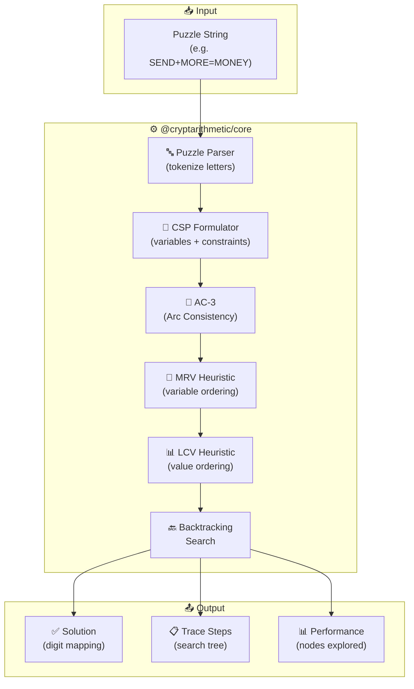
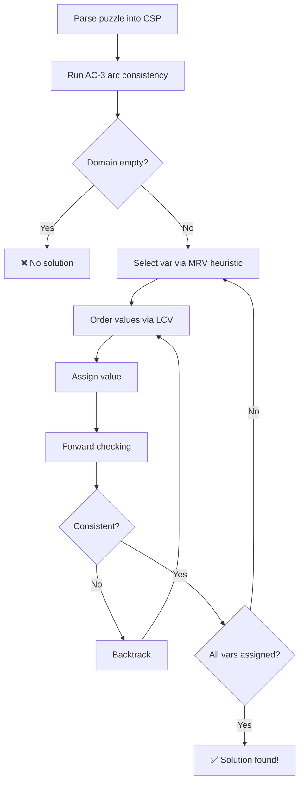

<div align="center">

# 🧩 Cryptarithmetic Puzzle Solver

**High-Performance CSP Solver with Interactive Visualizer**

[](https://github.com/harinish45/cryptarithmetic-solver/actions/workflows/ci.yml)
[](LICENSE)
[](https://typescriptlang.org)
[](vercel.json)

> *Solves SEND + MORE = MONEY in milliseconds using Backtracking + MRV + AC-3 with step-by-step visual exploration*

**Try: `SEND + MORE = MONEY` → solution in <5ms**

[📋 TODO](TODO.md) · [📄 PRD](PRD.md) · [🔍 Live Demo](#)

</div>

---

## 🏗️ Architecture



---

## 🔍 Search Algorithm Flow



---

## 🏎️ Performance

| Puzzle | Variables | Solution Time |
|--------|-----------|---------------|
| SEND + MORE = MONEY | 8 | ~3ms |
| BASE + BALL = GAMES | 8 | ~5ms |
| FORTY + TEN + TEN = SIXTY | 10 | ~12ms |

---

## 🚀 Quick Start

```bash
git clone https://github.com/harinish45/cryptarithmetic-solver.git
cd cryptarithmetic-solver
npm install
npm run dev          # Web UI → http://localhost:5173

# Or use the core package directly
cd packages/core
npx ts-node solve.ts "SEND+MORE=MONEY"
```

---

## 📦 Monorepo Structure

```
cryptarithmetic-solver/
├── 📦 packages/
│   ├── core/        # CSP solver engine (TypeScript)
│   ├── web/         # React web interface (Vite)
│   └── cli/         # Command-line interface
└── ⚙️  tsconfig.json
```

---

<div align="center">
<a href="LICENSE">MIT License</a> · Built by harinish45
</div>